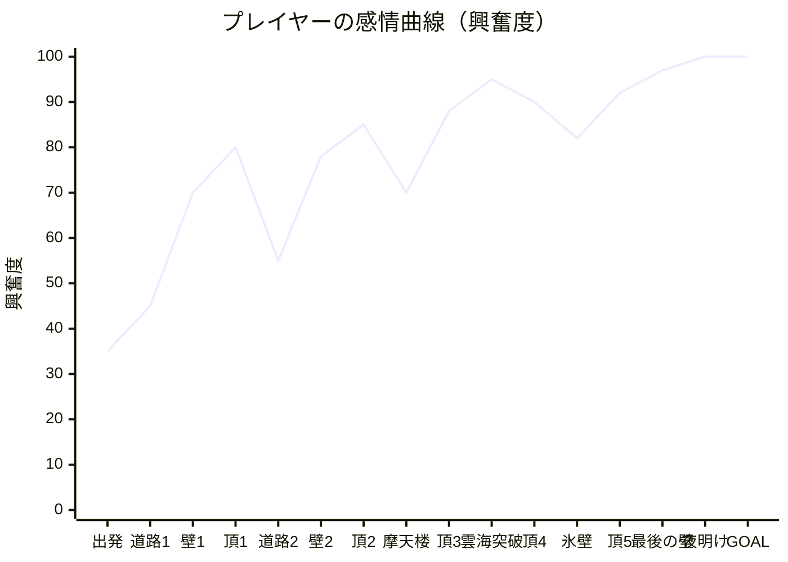

# 絶壁ロードスター — ジャーニーマップ設計書

> 「普段は道を走る車が、絶壁に出会ったら、そのまま垂直に駆け上がる」
> その一瞬の驚きと、頂を越えた瞬間の解放感を、**6回、だんだん大きく**味わわせる。

ベースは「スラスト・ロードスター ULTRA」（道路・谷・車列・リング・着地ガイド・合成サウンド）。
そこに **絶壁クライム** と **標高1000mを目指す旅（ジャーニー）** を足して、
プレイヤーの感情が「上がり続ける」ように全体を設計した。

---

## 1. 感情曲線（1プレイ ≒ 4〜5分）

**原則：谷（休息）は必ずあるが、毎回「前の山より高い山」を置く。**
道路区間で息を整え（＝期待を溜める）、壁で緊張を最大化し、頂で一気に解放する。
この「溜め → 緊張 → 解放」の 1 サイクルを 6 回、規模を上げながら繰り返す。

---

## 2. ジャーニーマップ（フェーズ別）

| フェーズ | プレイヤーの行動 | 心の声 | 感情 | ペインポイント（つまずき） | 設計での対策 |
|---|---|---|---|---|---|
| **① タイトル** | 地図を眺めて出発点を選ぶ | 「1000mって、どこまで行けるんだろう」 | 期待 | 何をするゲームか分からない | タイトルのロゴ自体が「壁を登る道」。**ジャーニーマップ**で旅の全体像と標高を先に見せる |
| **② 出発（CH1 海岸）** | シグナルで発進、最初の谷を跳ぶ | 「操作は簡単そう」 | 安心 → 高揚 | 操作が分からない | 前作の文脈ヒント・着地ガイドを継承。最初の谷は確実に越えられる長さ |
| **③ 最初の絶壁を見る** | 遠くに壁がそびえる | 「え、あれ登るの!?」 | **驚き** | 壁＝行き止まりに見えて怖い | 「絶壁まで170m」ゲート、助走路のブーストパッド、レーダー「▲絶壁まで◯m — 加速!」で**突っ込めばいい**と伝える |
| **④ 壁に食いつく** | そのまま突入、垂直に | 「登ってる!!」 | **興奮** | ルールが分からない | 最初の壁は60mで**勢いだけで登れる**（失敗しない）。金属音＋上昇ライザーで「食いついた」手応え |
| **⑤ 頂上ジャンプ** | 縁から空へ放り出される | 「うわ、飛んだ!」 | **解放・達成** | — | スローモーション＋サイドカメラ、BGMを一瞬止めて「ドロップ」、和音とベル、紙吹雪・花火、標高表示 |
| **⑥ 着地・次の章** | 着地、地図で次の章へ | 「次はどんな場所?」 | 満足 → 好奇心 | 満足して止めてしまう | **ジャーニーバナー**で地図上の車が次の頂へ移動。次の章名と標高を見せる。ライフ+1 |
| **⑦ 壁2〜3（キャニオン・摩天楼）** | 落石・岩棚をかわしながら登る | 「速度を落とせない…!」 | 緊張 | 失速・落石で理不尽に感じる | 落石は2秒近い予告（警告音・レーダー・赤い光）。失速前に心拍音と赤いビネット。リトライは**その壁の助走路から** |
| **⑧ 雲海突破（CH4）** | 壁の途中で雲を抜ける | 「雲の上に出た…!」 | **感動** | — | 雲の中でホワイトアウト→突き抜けて青空、専用効果音と「雲を突き抜けた!」演出。空の色も登るほど次の章へ変化 |
| **⑨ 氷壁（CH5）** | 氷で滑りながら登る | 「AIRが足りない…」 | 緊張（最大級） | AIR切れ | 壁のブーストパッドがAIR回復、AIRセル。助走路の看板「パッドで加速・AIRは壁に温存」で戦略を示す |
| **⑩ 最後の壁（CH6・320m）** | 夜空の中、最長の壁 | 「ここで落ちたくない」 | 緊張の頂点 | 長さで疲れる | 登るほど**夜明けの空にブレンド**。頂上に近づくほどドラムロールが細かくなる。あと100m・50m標識 |
| **⑪ 夜明けの頂・GOAL** | 朝日の中、ゴールゲート | 「登りきった!!」 | **最高潮** | — | 太陽が正面から昇る空、ファンファーレ、連続花火、タイム表示 |
| **⑫ リザルト** | 結果と地図を見る | 「次は★3を全部…」 | 誇り → 再挑戦意欲 | やり込む理由がない | 章ごとの★3（頂上へ／ノーミス／頂上パーフェクト着地）、登頂タイム、ランク、**到達した章から再挑戦** |

---

## 3. 「興奮が止まらない」ための仕掛け

### 3-1. エスカレーション（毎回、前より大きく）
| 章 | 舞台 | 壁の高さ | 新しい要素 |
|---|---|---|---|
| 1 | 黄金の海岸線（海・灯台・ヤシ） | 60m | 勢いだけで登れる |
| 2 | 赤岩キャニオン（滝・メサ） | 100m | 落石、壁のブーストパッド |
| 3 | ネオン摩天楼（ビル壁面を登る） | 140m | 岩棚（室外機）、ネオン |
| 4 | 雲海の断崖（夜明け前） | 170m | **雲海を突き抜ける** |
| 5 | オーロラ氷壁（雲の上） | 210m | 氷（滑る）、落石の連続 |
| 6 | 星の頂（星空 → 夜明け） | 320m | 全部入り、**日の出の中でゴール** |

### 3-2. 緊張と解放のコントラスト
- **緊張**：壁では重力で常に減速。噴射を長押しで加速、AIRが切れると失速→転落。
- **予告**：落石は「▼落石! 左の車線」＋警告音＋赤い光で約2秒前に知らせる（理不尽さを消す）。
- **解放**：頂の縁は50°のキッカー。速いほど高く遠くへ跳び、スロー＋横カメラで「見せ場」になる。

### 3-3. 視覚
- 壁に入るとカメラの「上」が壁面と一緒に回転し、世界が90°倒れる感覚。
- 絶壁には突き出した岩柱（バットレス）を並べ、登るとビル群のように流れ去る縦のパララックス。
- 登るほど空が次の章の空へブレンドし、最後は夜空が日の出に変わる。
- 雲海レイヤー（標高400m）：下からは曇天、中はホワイトアウト、上からは雲の海。
- 頂上：紙吹雪・花火・スローモーション、ゴール：連続花火。

### 3-4. 聴覚（すべて Web Audio でリアルタイム合成）
- 章ごとに調とテンポが変わるBGM（頂を越えるたびに新しい曲へ）。
- 壁の上では **16分ハイハット＋ベース倍速＋アルペジオ1オクターブ上＋フィルターが開いていくライザー**。頂上に近いほどスネアロールが細かくなる。
- 頂で**一瞬無音（ドロップ）→ 大和音とベルのアルペジオ**。
- 壁への食いつき音、心拍（失速）、落石の地鳴り、雲突破のシマー、ゴールのファンファーレ、花火。
- 標高が上がるほど風の音が強くなる。

### 3-5. 満足と継続
- ★3 × 6章 = 18個のスター、登頂タイム、ノーミス登頂で S ランク。
- 頂を越えると次の章が**出発地点として解放**（タイトルの地図から選べる）。
- 頂を越えるたびにライフ+1、AIRを補充 → 「越えれば報われる」。

---

## 4. 実装との対応

| 体験 | 実装 |
|---|---|
| 壁の形状 | `js/world.js` `climbShape()`：クォーターパイプ(R16) → 垂直壁 → リップ(R14, 90°→50°) |
| 壁の物理 | `js/game.js` `climbStep()`：重力 `G·sinθ`、グリップ、噴射、氷、パッド、失速判定 |
| 空中から壁へ | `W.climbContact()` → `enterClimb(..., caught)`（ウォールキャッチ） |
| 頂上ジャンプ | `launch()`：50°で射出、スロー・横カメラ・ドロップ・★判定 |
| 雲海 | `makeCloud()` / `updateCloud()`（標高400mのレイヤーと霧のホワイトアウト） |
| ジャーニーマップ | `journeySVG()`、タイトル・章間バナー・リザルトで共通 |
| クライムBGM | `js/audio.js` `setClimb()` / `drop()` |
